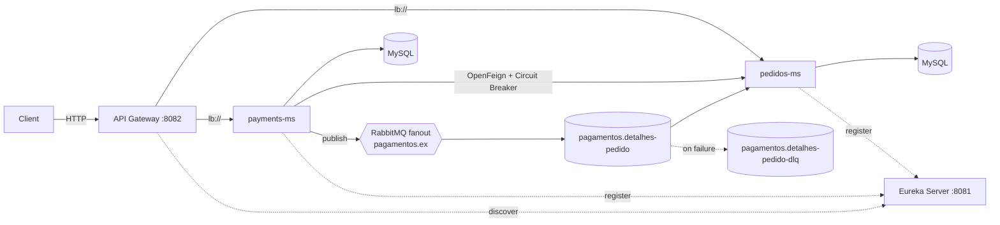

# Payments Microservice (`payments-ms`)

REST API responsible for **managing payments and confirming them against the Orders service**, built with **Java 17 and Spring Boot**. It demonstrates synchronous communication with **OpenFeign + Resilience4j circuit breaker** and asynchronous events with **RabbitMQ**.

    

## Tech stack
- Java 17, Spring Boot 2.6 (Web, Data JPA, Validation, AOP)
- Spring Cloud Netflix Eureka Client and Spring Cloud OpenFeign
- Resilience4j circuit breaker
- Spring AMQP / RabbitMQ (fanout exchange, JSON messages)
- MySQL + Flyway database migrations
- Lombok, Maven

## REST endpoints

| Method | Path | Description |
|---|---|---|
| `GET` | `/payments` | List payments (paginated) |
| `GET` | `/payments/{id}` | Get a payment by id |
| `POST` | `/payments` | Create a payment (status `CREATED`) and publish an event to `pagamentos.ex` |
| `PUT` | `/payments/{id}` | Update a payment |
| `DELETE` | `/payments/{id}` | Delete a payment |
| `PATCH` | `/payments/{id}/confirm` | Confirm a payment and notify the Orders service |

Payment status: `CREATED`, `CONFIRMED`, `CANCELED`.

## Resilience
`PATCH /payments/{id}/confirm` sets the payment to `CONFIRMED` and calls `PUT /pedidos/{id}/pago` on `pedidos-ms` through an OpenFeign client discovered via Eureka. The call is wrapped in a **Resilience4j `@CircuitBreaker`** with a fallback method, so failures in the Orders service do not cascade.

## Database
A Flyway migration creates the `payments` table (value, payer data, status, payment method and order id).

## Architecture

This service is part of a small **food-delivery backend built with Java and Spring Cloud microservices**:

| Repository | Responsibility | Default port |
|---|---|---|
| [spring-microservices-eureka-server](https://github.com/gomeschristopher/spring-microservices-eureka-server) | Service registry (Netflix Eureka) | `8081` |
| [spring-microservices-gateway-api](https://github.com/gomeschristopher/spring-microservices-gateway-api) | API Gateway (Spring Cloud Gateway) with discovery-based routing | `8082` |
| [spring-microservices-orders-api](https://github.com/gomeschristopher/spring-microservices-orders-api) | Orders REST API (`pedidos-ms`) | `8080` (default) |
| [spring-microservices-payments-api](https://github.com/gomeschristopher/spring-microservices-payments-api) | Payments REST API (`payments-ms`) | random (`server.port=0`) |



**Communication patterns**
- **Synchronous:** Payments calls Orders through an **OpenFeign** client resolved by Eureka, protected by a **Resilience4j circuit breaker** with a fallback.
- **Asynchronous:** when a payment is created, Payments publishes an event to a **RabbitMQ fanout exchange**; Orders consumes it with listener retries and a **dead-letter queue**.

## Running locally

Prerequisites: JDK 17, MySQL (configured on `localhost:3307`) and RabbitMQ (`localhost:5672`). Start the Eureka Server first; the service starts on a random port (`server.port=0`) and is reachable through the API Gateway.

```bash
./mvnw spring-boot:run
```

Adjust the datasource and RabbitMQ settings in `src/main/resources/application.properties` for your environment.

## About this project

Study project built while following Alura's microservices training (example domain: *AluraFood*), used to practice service discovery, API gateway routing, inter-service communication, resilience and messaging with the Spring ecosystem.

**Author:** Christopher Gomes — [LinkedIn](https://www.linkedin.com/in/christophgomes/) · [GitHub](https://github.com/gomeschristopher)
